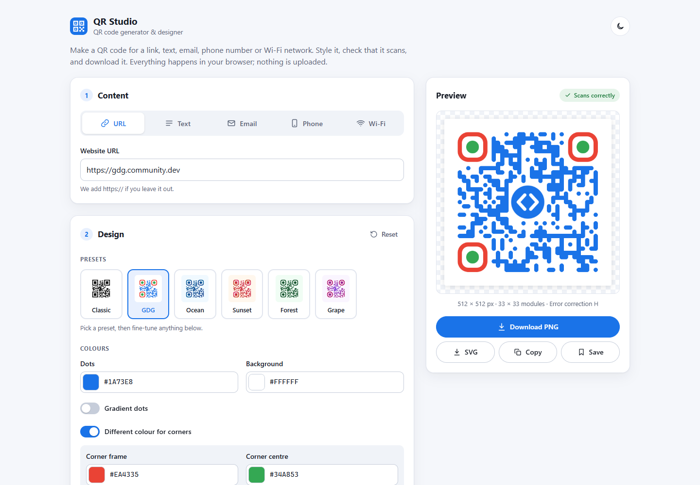
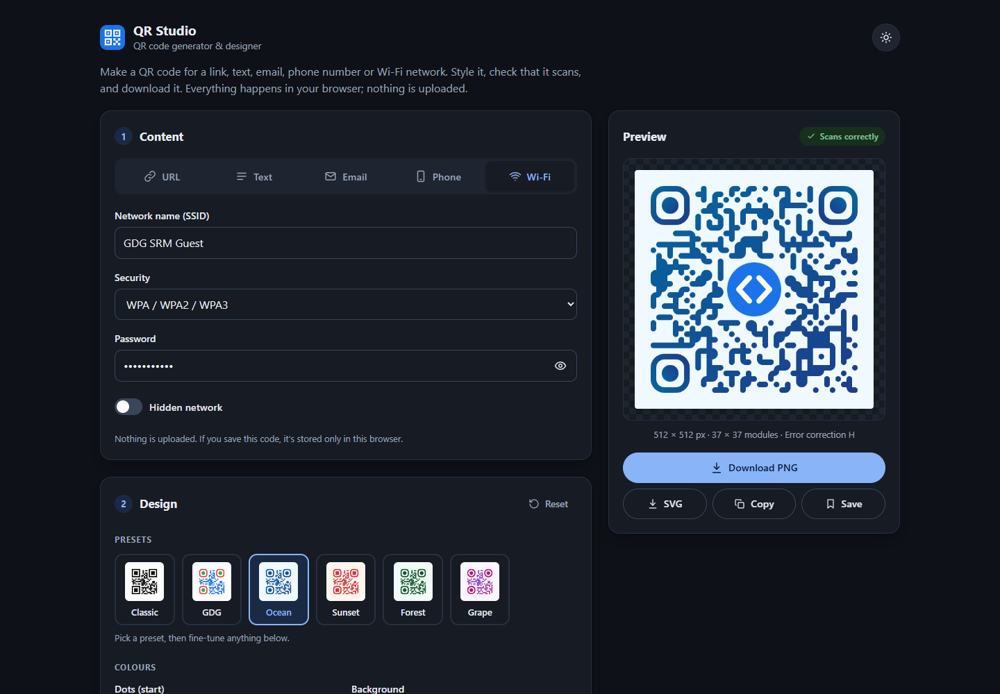
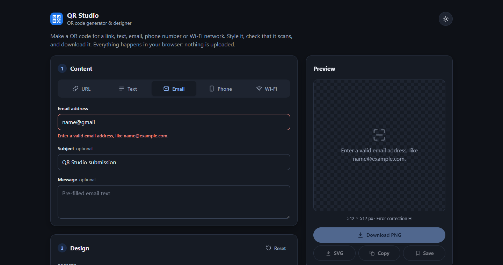
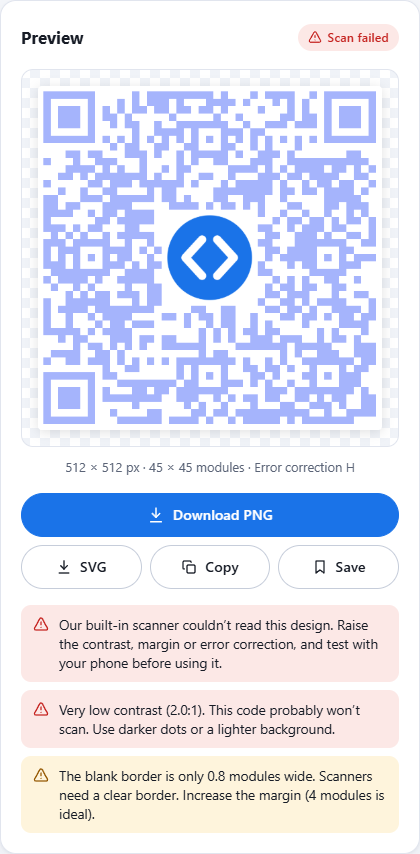
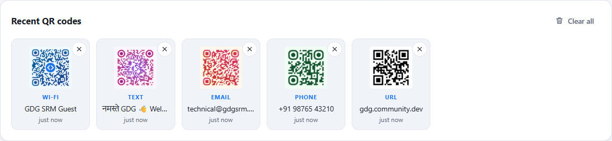
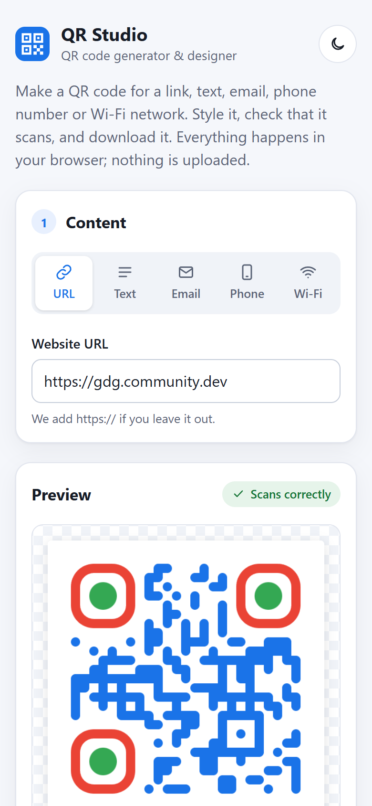
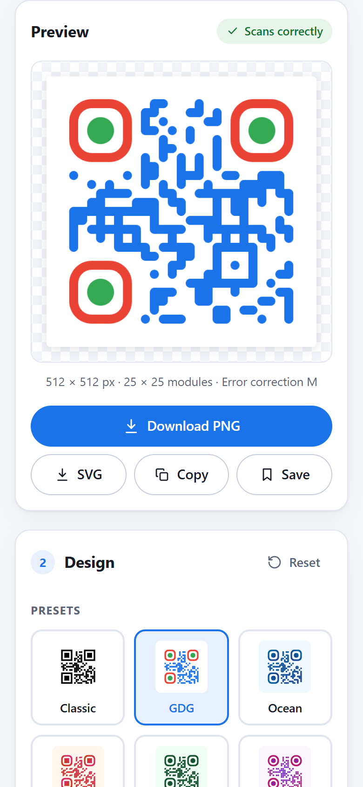
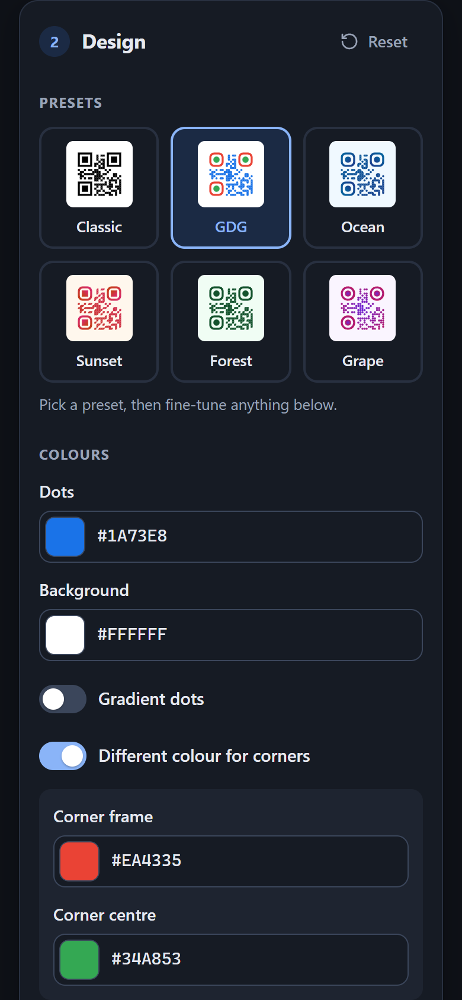

# QR Studio: QR Code Generator & Designer

A web app for creating, styling and downloading QR codes. It runs entirely in the browser with no backend.

Built for the **GDG on Campus SRM Recruitments 2026–27, Technical Domain, Frontend Task 1**.

**Live demo:** _add your Vercel link here_



## Features

| Requirement | How it's done |
| --- | --- |
| **QR generation** | The preview updates instantly as you type. The page opens with a sample URL so there's something to see right away. |
| **QR types** | URL, plain text, email (address, subject, message), phone number, and Wi-Fi (SSID, security, password, hidden network). Each type shows its own inputs, and switching types never loses what you typed. |
| **Customization** | Size (128–1024 px), dot colour, background colour, error-correction level (L/M/Q/H) and margin. Every change redraws the preview immediately. |
| **Presets** | Six built-in looks (Classic, GDG, Ocean, Sunset, Forest, Grape), each shown as a live mini QR code. After picking one you can still change every setting. |
| **Download** | PNG and SVG. Files come from the same QR instance and settings as the preview, so the download matches what you see. |
| **Validation** | Each type has its own rules: URL format, email address, phone digits, WPA/WEP password length, SSID length, and QR capacity for the chosen error-correction level. Errors appear under the field once you leave it, and downloads stay disabled until the input is valid. |
| **Scan reliability** | A **live scan test** decodes the generated image after every change, the way a phone camera would, and shows *Scans correctly* or *Scan failed*. Warnings also cover low contrast, inverted colours, a missing quiet zone, modules that are too small, logos that are too big or that need more error correction, and very dense codes. |
| **Recent QR codes** | Downloading, copying or saving a code adds it to *Recent*, which is stored in `localStorage` and survives a refresh. Click a recent code to load its content and design back into the editor. |
| **Responsive** | Two columns with a sticky preview on desktop, one column on phones. Tested at 375 px, 390 px, 1280 px and 1440 px. |
| **Testing** | 81 automated tests (Vitest + Testing Library) plus a manual test checklist. See [TESTING.md](TESTING.md). |

### Optional enhancements (all done)

- **SVG download** next to PNG
- **Logo in the centre.** Uploaded logos are resized and stored locally. Error correction is raised to H automatically.
- **Gradient QR codes**, linear (with angle) or radial
- **Copy to clipboard** as a PNG image
- **Custom QR patterns:** six dot styles, three corner-frame styles, two corner-centre styles, and separate corner colours
- **Dark / light theme.** Follows your system setting the first time, remembers your choice, and doesn't flash on load.

### Extras

- Correct **Unicode support** (emoji, Hindi, Tamil, accented letters). The QR library's built-in encoder garbles non-Latin text, so the app converts content to UTF-8 bytes first (`toByteString` in `src/lib/style.js`).
- Wi-Fi special characters (`; , : " \`) are escaped as the Wi-Fi QR format requires.
- Keyboard and screen-reader friendly: labelled inputs, error messages linked to their fields, arrow-key navigation between type tabs, visible focus rings, and reduced motion when the system asks for it.
- Nothing is uploaded anywhere. Wi-Fi passwords never appear in the Recent list labels.

## Screenshots

| Dark theme with a logo | Validation errors |
| --- | --- |
|  |  |

| Scan warnings | Recent QR codes |
| --- | --- |
|  |  |

| Mobile | Mobile preview | Mobile design (dark) |
| --- | --- | --- |
|  |  |  |

Full-page screenshot: [screenshots/desktop-full.png](screenshots/desktop-full.png)

## Tech stack

- [React 19](https://react.dev/) with [Vite](https://vite.dev/), JavaScript
- [qr-code-styling](https://github.com/kozakdenys/qr-code-styling) to draw styled QR codes (canvas/SVG, gradients, dot shapes, logos)
- [jsQR](https://github.com/cozmo/jsQR) to decode the generated image for the live scan test
- [qrcode-generator](https://github.com/kazuhikoarase/qrcode-generator) to calculate module counts for the warnings
- Plain CSS with custom properties for theming
- [Vitest](https://vitest.dev/) and [Testing Library](https://testing-library.com/) for tests
- Deployed on [Vercel](https://vercel.com/)

## Run it locally

You need [Node.js](https://nodejs.org/) 22.12 or newer (the current LTS works).

```bash
npm install      # download the libraries (first time only)
npm run dev      # start the app at http://localhost:5173
npm test         # run all automated tests
npm run build    # create the production version in dist/
```

## Project structure

```
src/
├── App.jsx                 Main screen: holds the state and connects the panels
├── main.jsx                Entry point
├── styles.css              All styling, including light/dark theme colours
├── components/
│   ├── ContentPanel.jsx    Type tabs and the input fields for each QR type
│   ├── StylePanel.jsx      Presets, colours, patterns, size, error correction, logo
│   ├── PreviewPanel.jsx    Live preview, scan test, warnings, download/copy/save
│   ├── RecentPanel.jsx     Recently generated QR codes
│   ├── controls.jsx        Reusable form controls (colour picker, slider, switch…)
│   └── Icon.jsx            Inline SVG icons
├── hooks/
│   ├── useQRCode.js        Draws the QR code whenever the options change
│   ├── useScanCheck.js     Decodes the rendered PNG to check it scans
│   ├── useRecent.js        Recent list state plus localStorage saving
│   ├── useTheme.js         Light/dark theme
│   └── useToast.js         Short status messages
└── lib/
    ├── qrTypes.js          Validation and payload building for each QR type
    ├── style.js            Default style, presets, conversion to library options
    ├── reliability.js      Contrast maths, module layout, scan warnings
    ├── recentStorage.js    Saving/loading Recent safely (handles full or corrupt storage)
    ├── image.js            Image resizing, QR decoding, clipboard
    └── format.js           Small formatting helpers
```

## How the scan check works

1. After you stop changing things (400 ms), the app asks qr-code-styling for the same PNG it would download.
2. The PNG is drawn on a hidden canvas and decoded with jsQR.
3. If the decoded text exactly matches the intended content, the badge says **Scans correctly**. Otherwise it says **Scan failed** and suggests fixes.

The rule-based warnings work alongside it. They use WCAG contrast ratios between every code colour (including gradient ends and corner colours) and the background, and they rebuild the QR matrix to measure the real module size and quiet zone in pixels.

## Design decisions

- **A new QR instance on every change.** qr-code-styling merges new options into old ones, which can leave stale settings behind (for example, a removed logo). Creating a fresh instance avoids that, and it's fast enough to feel instant.
- **Errors show after you leave a field**, not while you type, so you aren't interrupted halfway through an email address. The preview still says what's missing right away.
- **Recent codes are saved when you download, copy or press Save**, not on every keystroke, so the list holds real codes rather than half-typed ones. Duplicates move to the top instead of piling up. The list is capped at 12 entries, and if storage fills up the oldest entries are dropped.
- **Presets only change the look** (colours, gradient, patterns), never your content, size, margin or logo.
